# Отчёт: примерка дисков (ТЗ-1)

**Демо:** https://romagpt4444.github.io/wheel-fit-demo/
**Тот же код, другой бренд из конфига:** https://romagpt4444.github.io/wheel-fit-demo/?brand=kolesa
**Репозиторий:** https://github.com/Romagpt4444/wheel-fit-demo

## Проверки

| Проверка | Результат |
| --- | --- |
| `npm run build` | без ошибок; JS 18.8 КБ gzip при бюджете 150 КБ (бюджет проверяется и в CI) |
| Playwright, телефон 390 px и десктоп 1440 px | 8 из 8 локально и 8 из 8 на живом сайте (`E2E_URL=…`) |
| Сценарий: старт → авто → 3+ диска → PNG → форма → спасибо | пройден; PNG скачивается (> 80 КБ, с водяным знаком); текст заявки проверен |
| Тап по диску → кадр на Canvas | 10–23 мс (лимит 150 мс), замер в каждом прогоне |
| Своё фото: загрузка, перетаскивание кругов, щипок двумя пальцами, примерка | пройдено |
| Фильтры: R22, стиль, сортировка по цене | пройдено |
| Смена бренда только конфигом | цвета, шрифт заголовков, тексты, логотип, канал WhatsApp |
| Заявка через Worker | JSON + JPEG-превью 58 КБ (≤ 300 КБ); воркер — 5 юнит-тестов на моке Telegram |
| Консоль | ни одной ошибки или предупреждения (тесты падают на любом `console.error`/`warning`) |
| Lighthouse, живой сайт | главная (телефон) 100 / 100 / 100 / 100; примерка (телефон) 96 / 100 / 100 / 100; главная (десктоп) 100 / 100 / 100 / 100 |
| `prepare-wheel.py` | проверен с rembg (u2net) и `--no-rembg`: диск по центру, обод на радиусе 500 из 1024 |

Не проверено:
- **Реальная отправка в Telegram через бота.** Нет токена бота и аккаунта Cloudflare. На демо заявка уходит deep link'ом, воркер готов к деплою.
- **Живой телефон.** Проверял эмуляцией Pixel 7 в Playwright: sticky hover, клавиатуру и safe-area нужно один раз посмотреть на настоящем iPhone.

## Скриншоты (телефон)

| Главная | Гараж | Примерка |
| --- | --- | --- |
| 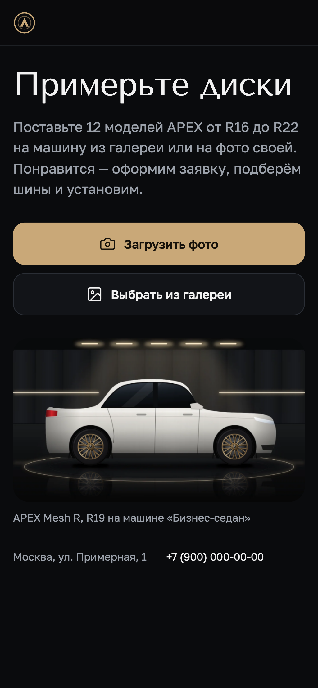 | 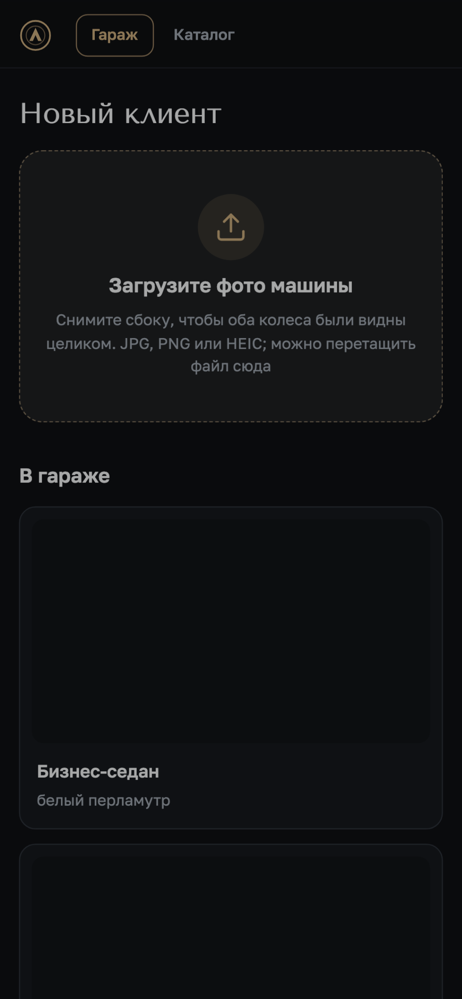 | 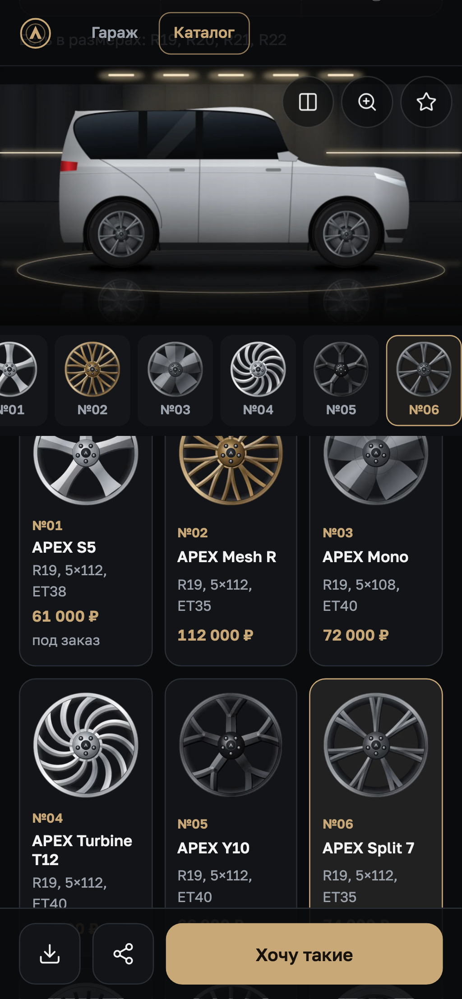 |

| Каталог «на машине» | Как было | Заявка |
| --- | --- | --- |
| 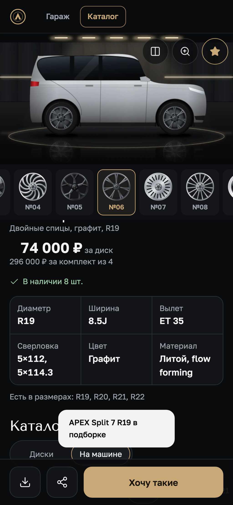 | 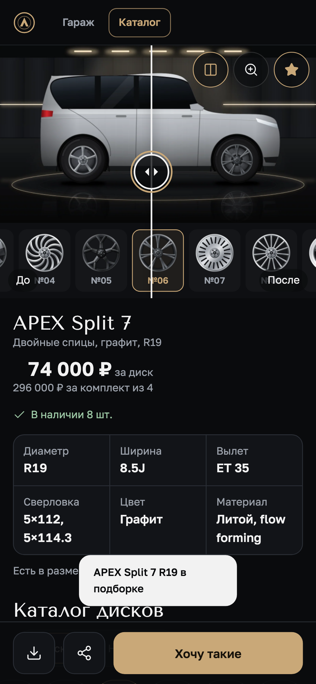 | 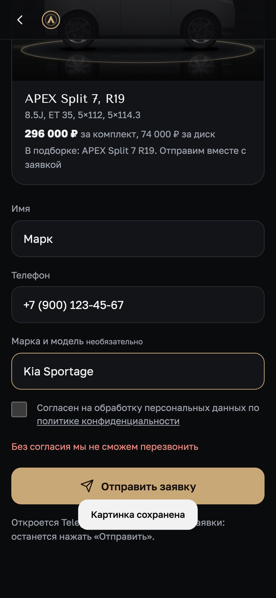 |

| Спасибо | Разметка своего фото | Своё фото с диском |
| --- | --- | --- |
| 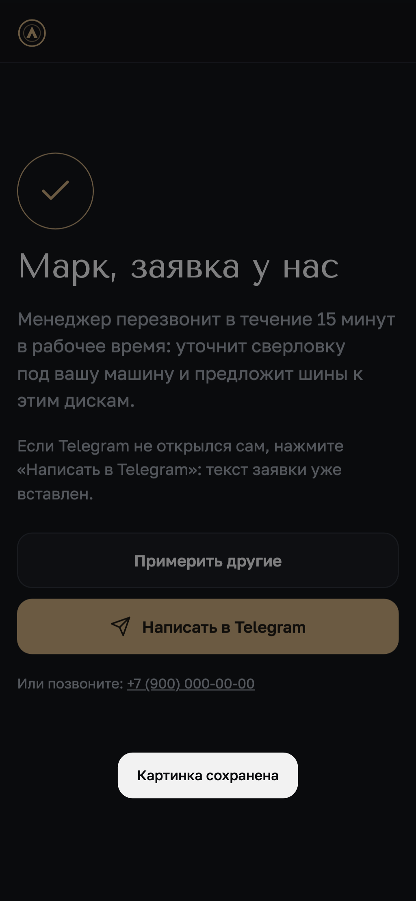 | 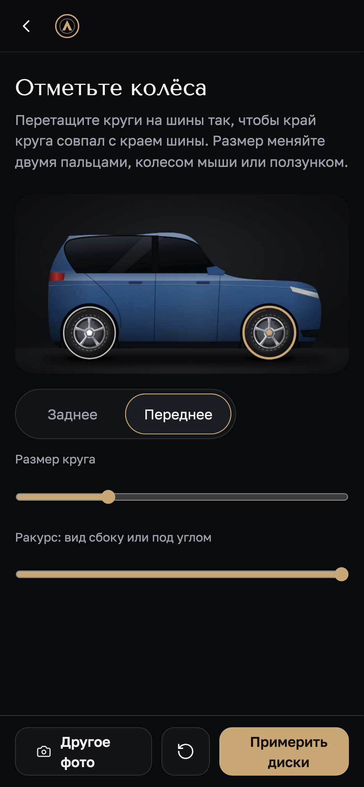 | 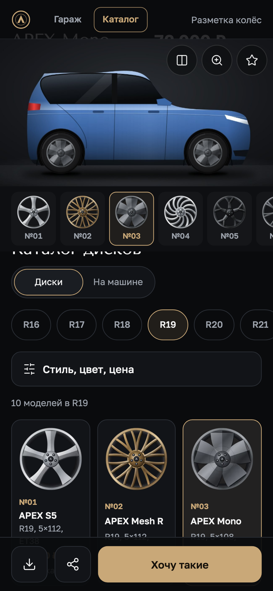 |

## Скриншоты (десктоп)

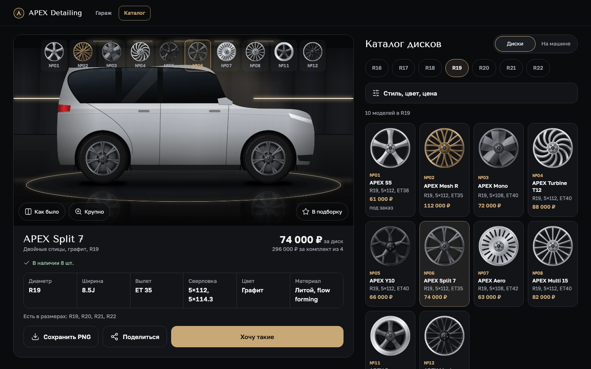
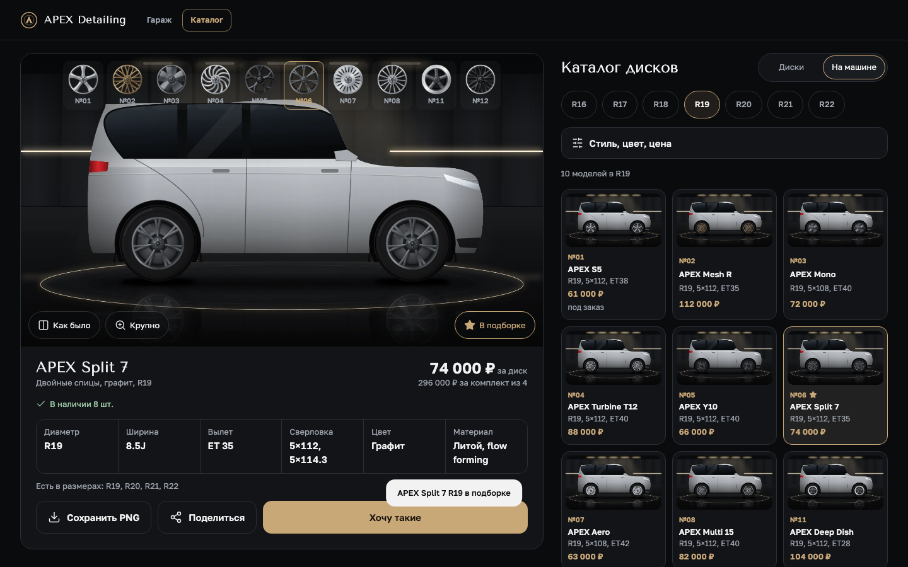
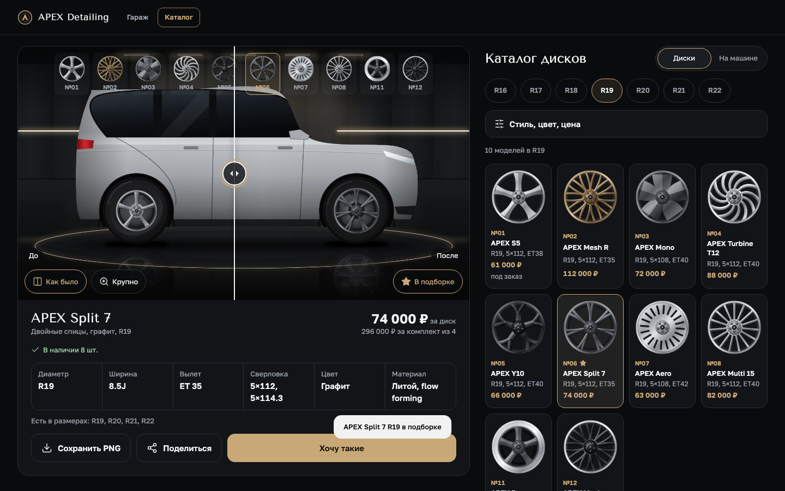
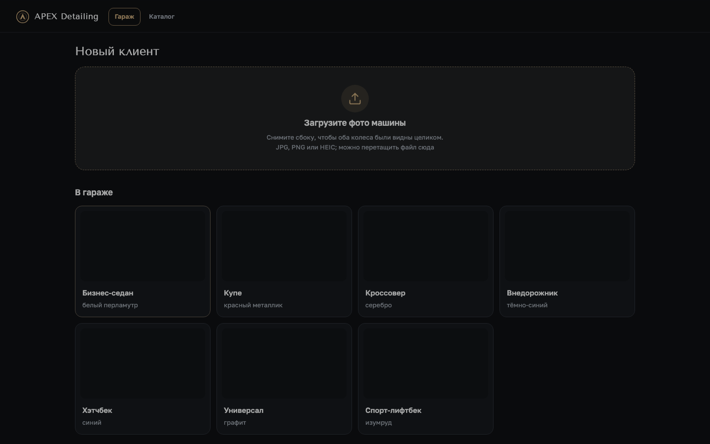
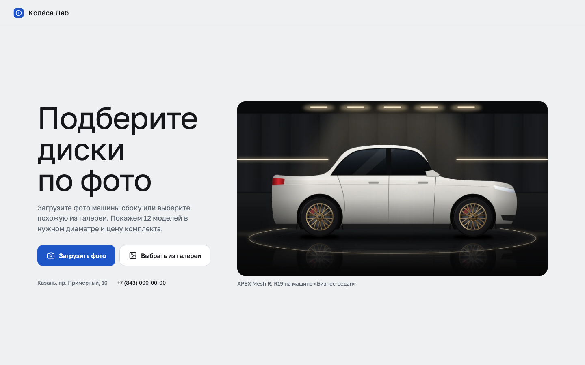

Решения — [DECISIONS.md](../DECISIONS.md); разбор видео-референса — [REFERENCE-NOTES.md](../REFERENCE-NOTES.md); скиллы — [SKILLS-USED.md](SKILLS-USED.md).
